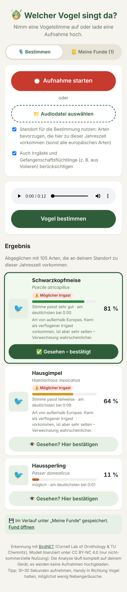

# 🐦 Vogelstimmen-Erkennung

**➡️ App öffnen: https://soerenmaterna-svg.github.io/vogelstimmen/**

Vogelstimme mit dem Handy aufnehmen oder Audiodatei hochladen – die App zeigt, welcher Vogel
das ist und wie sicher sie sich ist (in Prozent).

Die Erkennung läuft mit [BirdNET](https://birdnet.cornell.edu/) (Cornell Lab of Ornithology &
TU Chemnitz) **komplett im Browser auf deinem Gerät**. Es gibt keinen Server. Aufnahmen und Funde
werden nur im Browser auf deinem Gerät gespeichert (IndexedDB); nur für den Ortsnamen wird der
Standort an OpenStreetMap geschickt. Beim ersten Öffnen lädt die App das Erkennungsmodell (ca. 26 MB),
danach liegt es im Browser-Cache.



## Funktionen

- Aufnahme direkt im Browser mit Live-Spektrum (bis 2 Minuten), danach automatische Analyse
- Hochladen von Aufnahmen (mp3, m4a, wav, ogg, flac, webm …)
- Bis zu 5 Treffer mit Prozentwert, Wikipedia-Link und Vorschaubild
- **Europäische Arten** (559 Arten, siehe `data/europa_arten.txt`) werden bevorzugt
- Optional mit **Standort**: Arten, die dort im aktuellen Monat vorkommen, werden bevorzugt
- **Irrgäste und Gefangenschaftsflüchtlinge** werden auch erkannt, aber gekennzeichnet und
  erst ab einer höheren Sicherheit angezeigt:

  | Kennzeichnung | Bedeutung | angezeigt ab |
  |---|---|---|
  | – | erwartete Art | 10 % |
  | Selten hier | europäische Art, am Standort/zur Jahreszeit untypisch | 25 % |
  | Gefangenschaftsflüchtling? | Volieren-, Zoo- oder Parkvogel (`data/gefangenschaftsfluechtlinge.txt`) | 30 % |
  | Möglicher Irrgast | Art von außerhalb Europas | 50 % |

- Störgeräusche (Motor, Stimmen, Hund …) werden gemeldet
- **Meine Funde (Verlauf):** Jede Bestimmung wird mit Aufnahme, Datum, Uhrzeit und Fundort
  (Koordinaten, Ortsname über OpenStreetMap, Kartenlink) gespeichert. Pro Fund gibt es eine
  Notiz, und man kann die Aufnahme jederzeit wieder anhören.
- **„Gesehen“-Knopf:** Bei jedem erkannten Vogel lässt sich bestätigen, dass man ihn auch
  gesehen hat. Im Verlauf kann man nach bestätigten Sichtungen filtern.
- **Export:** Alle Funde als Tabelle (CSV, öffnet sich in Excel/LibreOffice)
- Lässt sich über „Zum Startbildschirm hinzufügen“ wie eine App aufs Handy legen

## Tipps für gute Ergebnisse

- 10–30 Sekunden aufnehmen, Handy Richtung Vogel halten
- Wind, Verkehr und Gespräche vermeiden
- Der Prozentwert ist die Sicherheit des Modells, kein Beweis. Bei seltenen Arten lieber
  ein zweites Mal hinhören oder hinschauen.

## Aufbau

| Datei/Ordner | Inhalt |
|---|---|
| `index.html`, `app.js`, `style.css` | Oberfläche (Aufnahme, Upload, Ergebnisse) |
| `birdnet.js` | Erkennung: Audio einlesen, Spektrogramm, Modell, Bewertung |
| `history.js` | Verlauf „Meine Funde“ (IndexedDB), Ortsname, CSV-Export |
| `model/` | BirdNET v2.4 als TensorFlow.js-Modell (Gewichte als float16) |
| `data/` | deutsche Namen, Europa-Artenliste, Standort-Raster, Gefangenschaftsflüchtlinge |
| `vendor/` | TensorFlow.js 4.22 mit WebAssembly-Backend |
| `tools/` | Python-Skripte, mit denen `model/` und `data/` erzeugt wurden |

Lokal testen: im Ordner `python3 -m http.server` starten und <http://localhost:8000> öffnen.

Daten neu erzeugen (Python 3.10+):

```bash
pip install -r tools/requirements.txt
```

```bash
cd tools && python make_europe_list.py && python build_data.py
```

## Lizenz der Modelle

Die BirdNET-Modelle stehen unter **CC BY-NC 4.0**. Private und nicht-kommerzielle Nutzung
ist erlaubt, kommerzielle Nutzung nicht.
